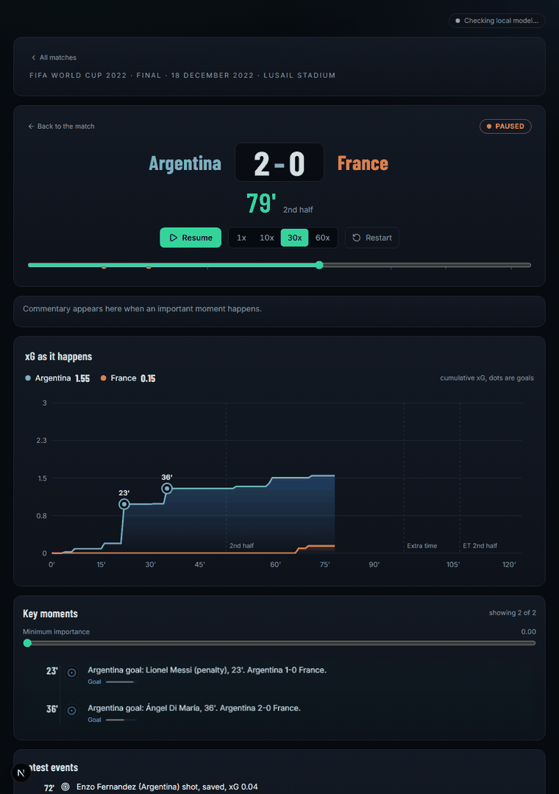
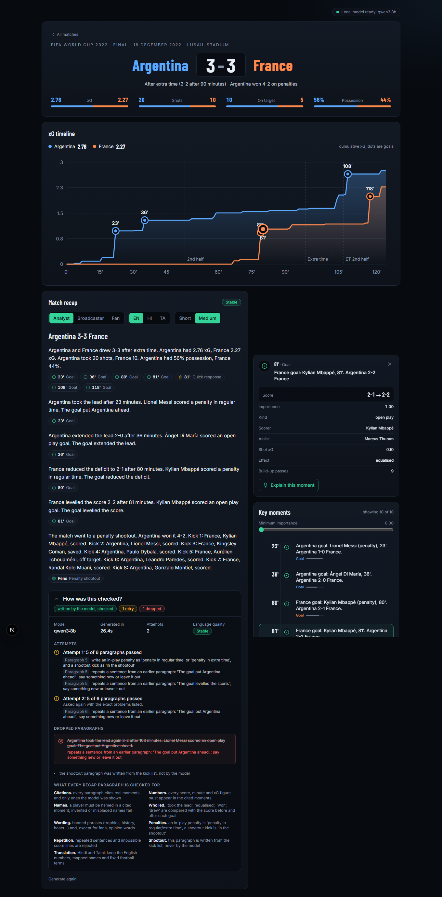
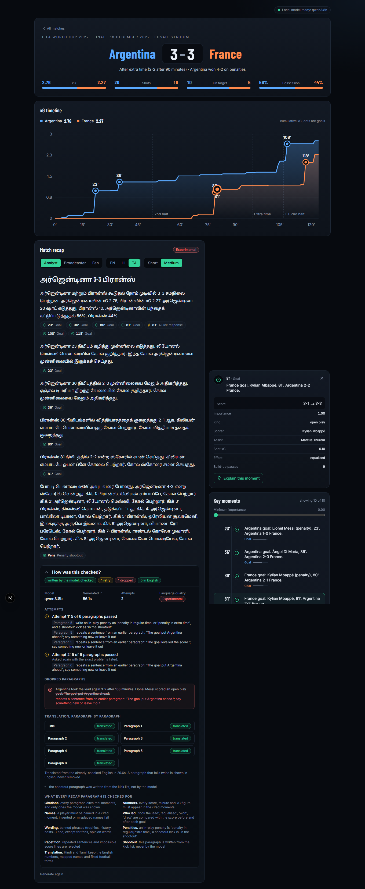
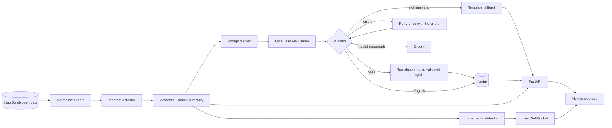

# MatchLens

**A football match explained by a local LLM that is not allowed to make things up: every sentence cites a detected moment, and a validator rejects invented numbers, names and claims.**

[](https://github.com/AdityaArun1435/MatchLens/actions/workflows/ci.yml)

     



*Live replay (30x) of the 2022 final from the 79th minute: the xG chart drawing in, captions, and moments appearing as they become detectable.*

| Match page (English) | Tamil recap | "How was this checked?" |
|---|---|---|
|  |  |  |

## Live site (in progress)

MatchLens is becoming a live football site on Vercel and Supabase: today's matches, live scores, fixtures, tables, lineups and events. Visitors only read from our own database; a scheduled job refreshes it within the free API limits. See [docs/live_site.md](docs/live_site.md) and [docs/data_sources.md](docs/data_sources.md). The matches below are kept under `/classic`.

## Why it's different

- **The LLM never sees raw data.** Plain Python detects the moments (goals, big chances, cards, momentum swings, substitution impact, quick responses, the shootout). The model gets only a short text rendering of those moments and the match summary.
- **Every sentence cites a detected moment.** Click a citation in the recap and the app jumps to the evidence.
- **A validator rejects what is not in the data.** Numbers, names, score-state verbs ("took the lead", "equalised"), shootout claims, banned phrases and opinion words are all checked. A failing paragraph is retried once with the exact errors, then dropped, and if nothing survives a deterministic template is used. The full report is one click away.
- **Runs fully offline on a laptop GPU.** Ollama with `qwen3:8b` (about 5 GB). No API keys, no paid services, no data leaves the machine.
- **Hindi and Tamil** are translated from the already-checked English and checked again (numbers, names, glossary), with a "Show English" toggle on every paragraph.
- **Live replay** over a WebSocket: moments are detected incrementally using only events up to the clock, and tests prove none is released early.

## Architecture



## Quick start (Windows, PowerShell)

```powershell
git clone https://github.com/AdityaArun1435/MatchLens; cd MatchLens
py -3.11 -m venv .venv; .\.venv\Scripts\pip install -r requirements.txt
.\.venv\Scripts\python scripts\fetch_data.py          # one-off StatsBomb download, about 11 MB
winget install Ollama.Ollama; ollama pull qwen3:8b    # only needed for new recaps
cd web; npm install; cd ..
.\start.ps1                                           # API on :8000, web app on :3000
.\start.ps1 -Fake                                     # no Ollama: canned recap for the 2022 final
```

Tests, all offline: `.\.venv\Scripts\python -m pytest`. Full technical reference (moment definitions, validation rules, API, prompts): [docs/reference.md](docs/reference.md). Demo walkthrough: [docs/demo_script.md](docs/demo_script.md).

## Limitations

- **Tamil is experimental** and Hindi is machine-translated. The name maps and football glossary are first drafts that nobody fluent has reviewed. A translation can keep every number and name and still shift the meaning.
- **Validation cannot catch everything.** It checks numbers, names, listed verbs and listed phrases. It cannot see a claim that uses no number or name (who dominated, why something happened), a real number attached to the wrong goal when both are cited, or outside knowledge phrased in plain words. The prompts forbid these; nothing enforces it.
- **An 8B model is an 8B model.** Prose is plain, sometimes repetitive, and a recap often needs its retry. Weak output is dropped or replaced by a template rather than improved.
- **Three matches only** are preloaded (2022 final, 2018 France v Argentina, 2022 Netherlands v Argentina). More can be added by id, but only from StatsBomb's open data.
- **The data cannot be redistributed.** StatsBomb's agreement forbids it, so `data/raw/` is not in this repository and each user fetches it with the script above. Tests that need it skip until you do.

## Tech stack

Python 3.11, FastAPI, Pydantic, WebSockets, Ollama (`qwen3:8b`), Next.js 16 with React 19 and Tailwind, Playwright, pytest. **360 tests** (offline; the Ollama integration tests skip when no server is running). CI runs pytest and the frontend lint and build on every push, with no Ollama.

## Attribution and licence

Data: **StatsBomb Open Data**, https://github.com/statsbomb/open-data, used under the StatsBomb Public Data User Agreement. If you publish analysis built on it, credit StatsBomb and use their logo ([media pack](https://statsbomb.com/media-pack/)). This project is not affiliated with or endorsed by StatsBomb.

Code: [MIT](LICENSE). The licence covers the source code only. The match data is not part of this repository and stays under StatsBomb's terms.
